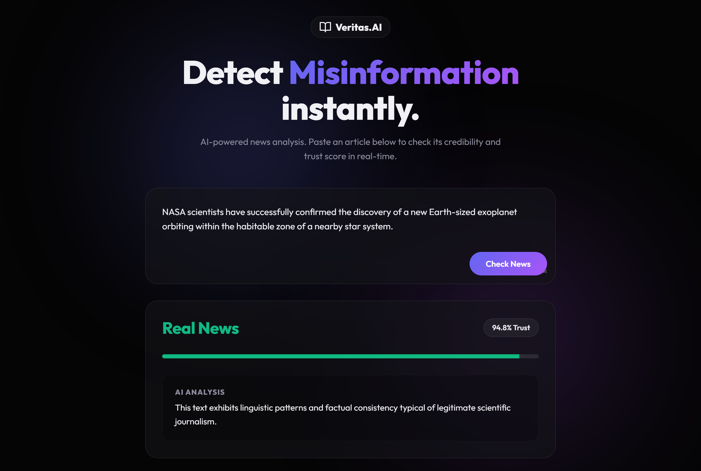

# 🔍 Veritas.AI — AI-Powered Fake News Detector

[](https://python.org)
[](https://fastapi.tiangolo.com/)
[](https://scikit-learn.org/)
[](LICENSE)

An intelligent, full-stack misinformation detection system powered by Machine Learning and Natural Language Processing (NLP). **Veritas.AI** analyzes statements, articles, and news headlines in real time to assess their credibility, predicting whether they are **Real News** or **Fake News** alongside an interactive **Trust Score**.

---

## 📸 Application Preview



---

## ✨ Features

- **⚡ Real-Time NLP Classification:** Uses a scikit-learn pipeline combining `TfidfVectorizer` and `LogisticRegression` to classify text snippets on the fly.
- **📊 Interactive Credibility / Trust Score:** Calculates an animated probabilistic trust metric (0–100%) indicating how confident the model is in the article's legitimacy.
- **🎨 Modern Glassmorphic UI:** Built with dark aesthetics, dynamic ambient glow effects, responsive card transitions, and animated score meters.
- **🔌 Decoupled RESTful Architecture:** High-performance asynchronous backend powered by **FastAPI** with CORS support for cross-platform integration.
- **🧠 Extensible Training Pipeline:** Modular model training script ready to scale to multi-thousand record datasets (e.g., Kaggle Fake News corpus).

---

## 🛠️ Tech Stack

| Layer | Technologies |
| :--- | :--- |
| **Frontend** | HTML5, Vanilla CSS3 (Custom Glassmorphism & Animations), JavaScript (ES6+ Fetch API) |
| **Backend** | Python 3.10+, FastAPI, Uvicorn (ASGI) |
| **Machine Learning / NLP** | scikit-learn (`TfidfVectorizer`, `LogisticRegression`), NLTK, joblib |

---

## 🚀 Quick Start Guide

### 1. Prerequisites
Ensure you have **Python 3.10+** installed on your system.

### 2. Backend Setup

1. Open your terminal and navigate to the project directory:
   ```bash
   cd backend
   ```

2. Create and activate a virtual environment:
   ```bash
   # Windows (PowerShell)
   python -m venv venv
   venv\Scripts\Activate.ps1

   # macOS / Linux
   python3 -m venv venv
   source venv/bin/activate
   ```

3. Install required dependencies:
   ```bash
   pip install -r requirements.txt
   ```

4. Train the AI model (generates `fake_news_model.pkl`):
   ```bash
   python model_trainer.py
   ```

5. Start the FastAPI development server:
   ```bash
   uvicorn app:app --reload
   ```
   The backend API will be live at `http://127.0.0.1:8000`. Interactive Swagger API docs are available at `http://127.0.0.1:8000/docs`.

---

### 3. Frontend Setup

The frontend runs on static web technologies with no compilation needed:
* Simply double-click `frontend/index.html` to open it in your browser.
* Or use **Live Server** in VS Code for automatic live-reloading.

---

## 📡 API Reference

### Analyze News
* **Endpoint:** `POST /analyze`
* **Content-Type:** `application/json`

#### Request:
```json
{
  "text": "NASA successfully launched its new rover to Mars this morning."
}
```

#### Response:
```json
{
  "is_real": true,
  "prediction_label": "Real News",
  "trust_score": 94.8,
  "explanation": "This text appears to be legitimate news based on our analysis."
}
```

---

## 📂 Project Structure

```text
ai-fake-news-detector/
├── assets/
│   └── preview.png          # High-resolution application preview screenshot
├── backend/
│   ├── app.py               # FastAPI application with inference API
│   ├── model_trainer.py     # NLP training pipeline (TF-IDF + Logistic Regression)
│   ├── fake_news_model.pkl  # Trained serialized model
│   └── requirements.txt     # Python dependencies
├── frontend/
│   ├── index.html           # Veritas.AI web interface
│   ├── style.css            # Dark mode glassmorphic styling & keyframes
│   └── script.js            # Client-side API integration & DOM manipulation
├── .gitignore               # Ignored environments and artifacts
└── README.md                # Project documentation
```

---

## 📈 Scaling the AI Model

The included `model_trainer.py` comes pre-configured with a starter dataset to demonstrate pipeline functionality out of the box. To train for production accuracy:
1. Download a comprehensive fake news dataset (e.g., from [Kaggle Fake and Real News Dataset](https://www.kaggle.com/clmentbisaillon/fake-and-real-news-dataset) or [WELFake](https://www.kaggle.com/datasets/saurabhshahane/fake-news-classification)).
2. Update `model_trainer.py` to ingest the CSV using pandas.
3. Re-run `python model_trainer.py` to generate an updated `fake_news_model.pkl`.

---

## 📄 License
This project is licensed under the [MIT License](LICENSE).
